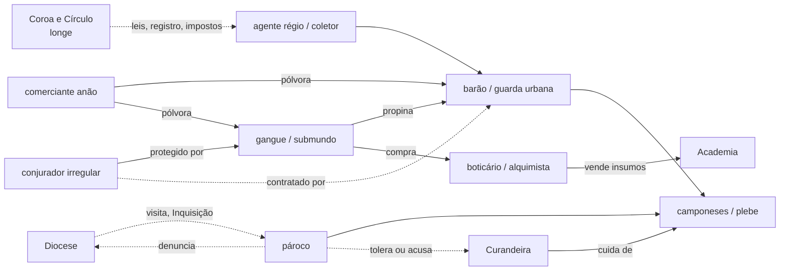

# Tracton — mapa de relações locais do Tier 1 (entregável E)

Pedido do [adendo](../../00-fontes/adendo-autoral-tracton-p1.txt), §16 e §19-E: o primeiro conto canônico de Argon é no **Tier 1** (CANONE #21). Priorizar barões, senhores locais, oficiais, soldados, mercenários, sacerdotes regionais, comerciantes, artesãos, alquimistas, criminosos, conjuradores menores e gente comum. As instituições centrais aparecem por **leis, impostos, privilégios, fiscalização, documentos e agentes locais**.

> ⚙️ 5e: no D&D 5e, "Tier 1" costuma designar os **níveis 1 a 4** ("heróis locais"), em que as ameaças são a fazendas, aldeias e bairros (`[M]`, conferir no SRD). Isso bate com o adendo e responde em parte à pergunta #18.

**Este é um mapa de tipos de relação, não de personagens.** Não crio nomes. A ideia é ter à mão quem existe numa localidade de Tracton e como essas pessoas se prendem umas às outras, antes de qualquer trama (CANONE #3: a narrativa nasce das causas do mundo).

> ❓ **Época:** o adendo descreve Tracton para o primeiro conto canônico, que supus ser a **2ª vida de Argon, 300 anos depois** (CANONE #10). O mapa abaixo serve às duas épocas; o que muda depois de Argon está na seção 4. (Pergunta #32.)

---

## 1. Duas localidades-tipo

> 💡 O conto já dá dois ambientes de Tier 1. Uso os dois como molde, sem fixar lugar:
> - **Bairro portuário** de uma cidade com Academia (como o Cais da Lama).
> - **Vale de fronteira** com castelo, vila e aldeias (como Vallenar), onde a Semente foi distribuída.

## 2. Atores locais e suas relações

### Bairro portuário
| Ator | O que controla | Depende de | Teme | Liga-se a |
|---|---|---|---|---|
| **Oficial da guarda urbana** | prisões, vistas grossas | salário da cidade, propinas | caçadores da Coroa, escândalo | gangues (propina), mercadores (proteção) |
| **Chefe de gangue** | proteção, contrabando, tráfico, justiça de rua | guarda comprada, rotas | rivais, caçadores | boticários (compra), traficantes de pessoas, pólvora contrabandeada |
| **Mercador ou capitão** | rotas, cargas, crédito | alfândega, seguro, marinheiros | piratas, fisco | anões (pólvora, metal), colônias do sul, gangues (descarga) |
| **Comerciante anão** | pólvora, metal | licença ou contrabando | ❓ (opaco) | Coroa, mercadores, gangues (CANONE #18) |
| **Boticário ou alquimista de bairro** | drogas, remédios, insumos | clientes, fornecedores de ervas e minérios | Inquisição, Guilda | Academia (vende insumos), gangues (vende drogas), doentes |
| **Curandeira ou benzedeira** | cura, partos, confiança | vizinhança | pároco, acusação de heresia | plebe, às vezes o próprio pároco |
| **Pároco do bairro** | sacramentos, registro de batismo e óbito, sermão | bispo, dízimo | heresia, abandono | todos; **sabe quem nasceu e quem morreu** |
| **Diplomado menor** | um ou dois círculos, contratos | Círculo, patronos | perder registro, irregulares concorrentes | mercadores (proteção de carga), nobres menores |
| **Conjurador irregular** | pouco poder, muito segredo | clientes, silêncio | denúncia | gangues (proteção), boticários (insumos) |
| **Dono de cortiço ou bordel** | moradia e trabalho precário | gangue, guarda | fiscalização | traficantes de pessoas (📜 vende meninos aos baleeiros) |
| **Coletor de impostos ou alfândega** | taxas, papéis | Coroa | contrabando, violência | mercadores, guarda |
| **Famílias trabalhadoras** | pouco | trabalho, vizinhança | doença, fome, ser levado | pároco, curandeira, patrões; **festas e afetos** (CANONE #16) |

### Vale de fronteira
| Ator | O que controla | Depende de | Teme | Liga-se a |
|---|---|---|---|---|
| **Barão ou conde** | terra, justiça senhorial, homens armados, minas e pedágios | camponeses, aliados, casamento | vizinho, interdito real, perder herdeiro | Coroa (só de nome), bispo, mercenários |
| **Comandante de armas** | tropa | soldo do senhor | motim, derrota | soldados, mercenários |
| **Mercenários** | força por contrato | soldo, saque | não receber | quem pagar; pólvora |
| **Bailio, mordomo ou escrivão** | contas, registros, tributo | senhor | auditoria, rivais na corte do senhor | camponeses, mercadores |
| **Pároco de aldeia** | sacramentos, registros, consciência | bispo, dízimo | heresia, senhor | **canal da Igreja para a diocese**; sabe mais que o senhor |
| **Ferreiro, mineiro, moleiro** | ofícios essenciais | senhor (monopólio de moinho? ❓) | acidentes, impostos | aldeia, mercadores |
| **Camponeses** | colheita, gado, costumes | senhor, clima | guerra, fome, recrutamento | pároco, curandeira, **cultos locais antigos** (💡) |
| **Mascate ou comerciante itinerante** | notícias, mercadorias | estradas | bandidos, pedágios | todos; **traz o mundo de fora** |
| **Caçador de recompensa ou agente régio de passagem** | raro, temido | ordem da capital | ser morto longe de casa | senhor (precisa da cooperação dele) |

## 3. Mapa de relações (resumo)

> 💡 **Três linhas que o Tier 1 usa sem precisar de alta política:**
> 1. **Papel × palavra:** quem tem registro (diplomado, mercador, pároco com o livro de batismos) e quem vive de reputação (gangue, curandeira, irregular). Documentos são poder local.
> 2. **Quem soube primeiro:** o pároco e o boticário sabem coisas que o senhor e a Coroa não sabem. Informação circula por dívidas e favores.
> 3. **Insumos e drogas:** a mesma cadeia que abastece a Academia abastece o vício (lótus branco e azul). Pelo CANONE #20, Argon pode entrar nessa cadeia no início, em escala local.

## 4. O que muda 300 anos depois (💡, pendente da pergunta #32)
- A **Ordem do Selo de Chumbo** tem presença local: informantes, "cães" (📜 dossiê). O irregular fica mais caro e mais lucrativo.
- O **pároco** pode virar o elo com o **Sacerdócio do Glifo**: o livro de batismos vira lista de suspeitos?
- As **14 famílias** da Semente estão espalhadas pelo vale e além, sem saber. Elas são camponeses comuns, com vizinhos, dívidas e festas, não "portadores".
- A pólvora e as armas anãs podem ter mudado (mais comuns? mais caras?). ❓
- 📜 O dossiê Argon & Malakor fala em **Cinzália** como cidade da 2ª vida e na **caravana da Salmoura**. São hipóteses (CANONE #6; perguntas #14 e #16).

## 5. Limites (adendo §16, §20)
- Não levar Argon à alta política nem forçar encontros com a realeza.
- Não criar conflitos só para gerar aventura (erro proibido 22): as relações acima existem sem Argon.
- Não criar uma organização criminosa única que controle as drogas (CANONE #20).
